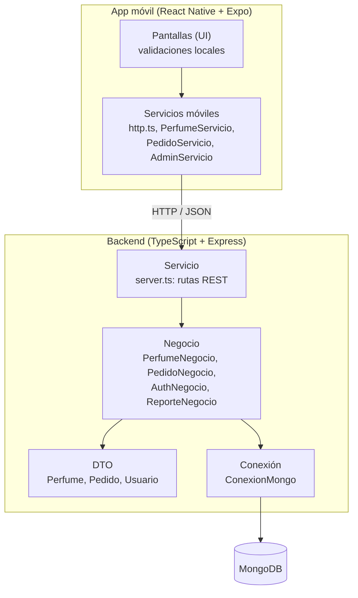
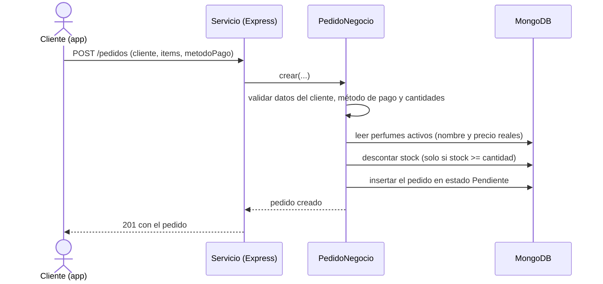
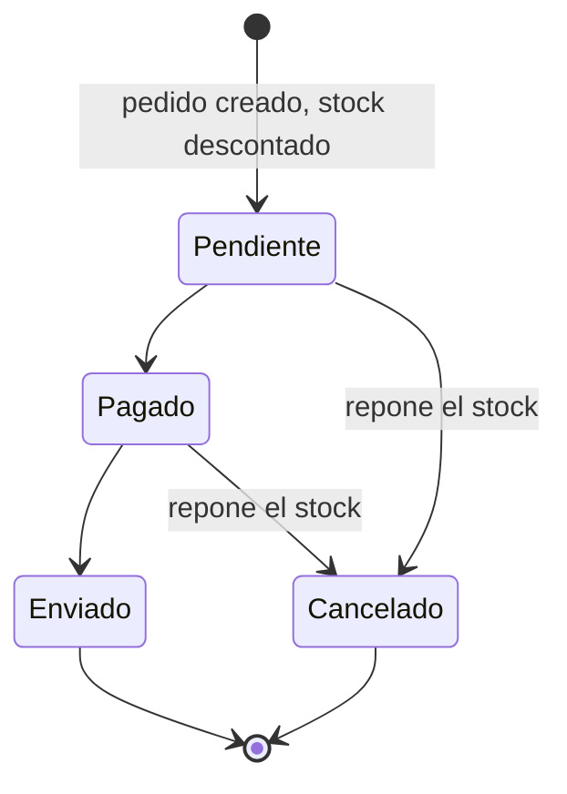

# Arquitectura

El sistema sigue una **arquitectura orientada a servicios (SOA) en capas**. Cada capa tiene una sola
responsabilidad y solo conoce a la capa que tiene debajo.

## Vista general

## Capas del backend

| Capa | Archivos | Responsabilidad | Lo que NO hace |
|---|---|---|---|
| Conexión | `src/conexion/ConexionMongo.ts` | Abre la conexión a MongoDB una sola vez y entrega colecciones y sesiones | No conoce reglas de negocio |
| DTO | `src/dto/Perfume.ts`, `Pedido.ts`, `Usuario.ts` | Réplica de las colecciones de la base de datos | No tiene lógica ni acceso a datos |
| Negocio | `src/negocio/*.ts` | Todas las operaciones sobre los datos (insertar, consultar, actualizar), validaciones y reglas | No se conecta directo a MongoDB: usa la capa de conexión y los DTO |
| Servicio | `src/servicio/server.ts` | Recibe peticiones HTTP, llama a la capa de negocio y responde en JSON | No contiene reglas de negocio ni importa DTO ni conexión |

**Regla de dependencias:** Servicio → Negocio → (DTO, Conexión). Nunca al revés.

Los errores de negocio se lanzan como `ErrorNegocio`, que lleva un código HTTP sugerido (400, 404, 409...).
La capa de servicio los traduce a la respuesta sin conocer la regla que falló.

## Capas de la app móvil

| Capa | Carpeta | Responsabilidad |
|---|---|---|
| UI | `app-movil/src/pantallas`, `componentes` | Mostrar datos y validar formularios localmente |
| Servicios | `app-movil/src/servicios` | Único lugar que conoce la URL del backend y usa `fetch` |
| Estado | `app-movil/src/estado` | Carrito de compras y sesión del administrador (en memoria) |
| Navegación | `app-movil/src/navegacion` | Pila de pantallas, botón "atrás" de Android y protección de pantallas admin |
| Modelos y utilidades | `app-movil/src/modelos.ts`, `utilidades` | Tipos, formato de precios y fechas, validaciones |

Las pantallas nunca llaman a `fetch` directamente: siempre pasan por los servicios.

## Flujo de una compra

## Estados de un pedido

El flujo está definido en `TRANSICIONES` (`src/negocio/PedidoNegocio.ts`) y lo valida el backend:
no se puede saltar un paso, ni cancelar un pedido enviado, ni reactivar uno cancelado.

## Decisiones de diseño y sus razones

1. **El precio y el nombre salen siempre de la base de datos.** El servidor ignora cualquier precio que
   envíe la app, para que nadie pueda alterar el total de una compra.
2. **Descuento de stock atómico.** Cada línea se descuenta con una actualización condicional
   (`stock >= cantidad` con `$inc`), así dos clientes que compran el último frasco al mismo tiempo no
   dejan el stock en negativo: uno gana y el otro recibe un 409.
3. **Stock reservado al crear el pedido.** El descuento ocurre al registrar el pedido (RF-02), no al pagarlo.
   Por eso existe la cancelación: devuelve el stock al inventario.
4. **Cancelación con guarda de estado.** Primero se cambia el estado con una condición ("solo si sigue en
   el estado que leí") y después se repone el stock. Si dos cancelaciones llegan a la vez, solo una gana y
   el stock se repone una sola vez.
5. **Transacciones opcionales.** Con `USAR_TRANSACCIONES=true` (requiere MongoDB como replica set, por
   ejemplo Atlas) el descuento y la creación del pedido son una sola transacción. Con `false` (MongoDB local
   normal) el código deshace a mano el descuento si algo falla.
6. **Baja lógica.** Un perfume dado de baja pasa a `activo: false`: desaparece del catálogo, pero los
   pedidos anteriores conservan su nombre y precio (se guardan copiados dentro del pedido).
7. **Seguridad del panel admin.** Contraseñas con hash (bcrypt), token JWT que vence a las 8 horas, rutas
   `/admin/*` protegidas, y el mismo mensaje de error si falla el correo o la contraseña. En la app el token
   vive solo en memoria y, si vence, se vuelve al login automáticamente.
8. **Validación en dos lugares.** El backend es la autoridad (la capa de negocio valida todo); la app
   valida además de forma local para dar respuesta inmediata al usuario.
9. **Navegación propia en la app.** Se implementó una pila de pantallas mínima en vez de una librería, para
   evitar problemas de compatibilidad de versiones con Expo.

## Límites de seguridad conocidos (para producción)

- El tráfico en desarrollo va por HTTP sin cifrar; en producción debe usarse HTTPS.
- CORS está abierto a cualquier origen; conviene restringirlo al dominio real.
- No hay límite de intentos de login ni de peticiones.
- El panel de administración vive dentro de la misma app del cliente; solo el token lo protege. En
  producción se separaría en una app o sitio distinto.
