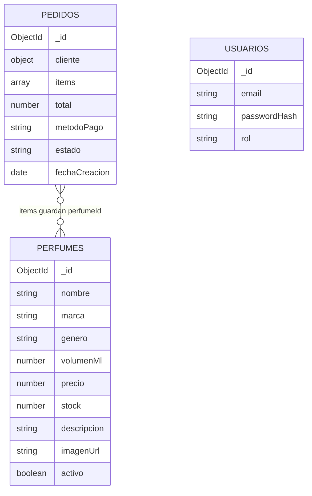

# Modelo de datos (MongoDB)

Base de datos: `perfumeria` (configurable con `MONGO_DB`). Tres colecciones.

## perfumes

| Campo | Tipo | Notas |
|---|---|---|
| `_id` | ObjectId | |
| `nombre` | string | Obligatorio |
| `marca` | string | Obligatoria |
| `genero` | `"Hombre"` / `"Mujer"` / `"Unisex"` | Obligatorio |
| `volumenMl` | number | Mayor a 0 |
| `precio` | number | Mayor a 0 |
| `stock` | number | Entero, 0 o más |
| `descripcion` | string | Opcional |
| `imagenUrl` | string | Opcional; la app solo muestra URLs que empiezan con `http://` o `https://` |
| `activo` | boolean | `false` = baja lógica |

## pedidos

| Campo | Tipo | Notas |
|---|---|---|
| `_id` | ObjectId | Los últimos 6 caracteres se muestran como número de pedido |
| `cliente` | objeto embebido | `nombre`, `telefono`, `direccion`, `ciudad` (obligatorios) y `email` (opcional) |
| `items` | arreglo embebido | Cada ítem: `perfumeId`, `nombre`, `precioUnitario`, `cantidad` |
| `total` | number | Calculado por el servidor con los precios de la base de datos |
| `metodoPago` | string | `transferencia`, `contra_entrega` o `pasarela` |
| `estado` | string | `Pendiente`, `Pagado`, `Enviado` o `Cancelado` |
| `fechaCreacion` | date | Asignada por el servidor |

Los ítems guardan una **copia** del nombre y el precio al momento de la compra: si el catálogo cambia
después, los pedidos antiguos no se alteran.

## usuarios

| Campo | Tipo | Notas |
|---|---|---|
| `_id` | ObjectId | |
| `email` | string | Se guarda en minúsculas |
| `passwordHash` | string | Hash bcrypt; nunca se guarda la contraseña |
| `rol` | `"admin"` | Solo existen administradores en el MVP |

## Reglas de validación (capa de negocio)

- **Perfume:** nombre y marca obligatorios; género válido; volumen y precio mayores a 0; stock entero igual
  o mayor a 0.
- **Pedido:** carrito no vacío; cada cantidad es un entero mayor a 0; nombre, teléfono, dirección y ciudad
  obligatorios; el teléfono admite entre 7 y 15 caracteres entre números, `+`, espacios y `-`; método de pago
  válido; todos los perfumes deben estar activos y con stock suficiente.
- **Cambio de estado:** solo las transiciones permitidas (ver [ARQUITECTURA.md](ARQUITECTURA.md)).
- **Reporte:** `desde` y `hasta` deben ser fechas válidas y `desde` no puede ser posterior a `hasta`;
  `umbralStock` debe ser un entero igual o mayor a 0.

## Pendiente

No se crean índices automáticamente. Para un catálogo grande conviene agregar índices sobre
`perfumes.activo`, `perfumes.marca`, `pedidos.estado` y `pedidos.fechaCreacion`.
